<div align="center">

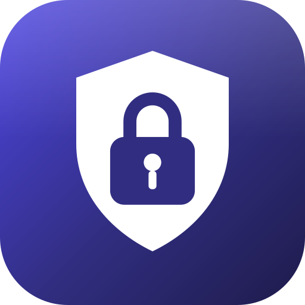

# GuestVault

**Borrow my phone. Keep your privacy.**

A practical, privacy-first Guest Mode for Android phones that don't ship one.

[](https://github.com/Jacinth-19/GuestVault/actions/workflows/android.yml)
[](https://github.com/Jacinth-19/GuestVault/actions/workflows/media.yml)
[](https://github.com/Jacinth-19/GuestVault/actions/workflows/play.yml)


</div>

---

GuestVault lets you hand your phone to a friend, a child or a stranger without handing over your life.
Pick the apps they may use, hand over the phone, and take it back with your PIN or fingerprint.
Everything else — gallery, messages, files, settings, Play Store — stays behind the lock.

<div align="center">

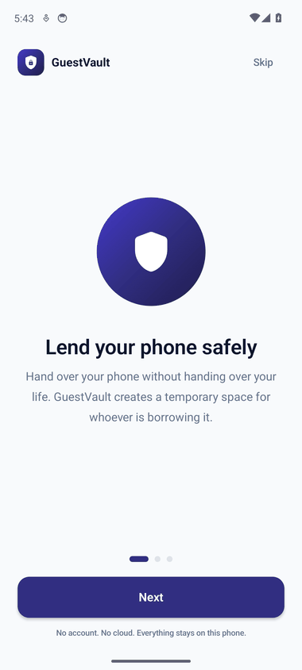

<sub>Onboarding → dashboard → allow-list → restricted guest home → PIN-protected exit</sub>

</div>

## 🎬 Demo

**▶ [Watch the 94-second walkthrough (MP4)](docs/media/walkthrough.mp4)** — recorded on a Pixel 6
emulator by the `Screenshots & Demo Video` workflow: splash → onboarding → PIN → dashboard →
allow-list → session setup → guest home → wrong PIN → unlock → history → dark mode.

<sub>Screenshots and the video are produced by CI from the real app — no mockups, no editing.</sub>

## 📸 Screens

**Getting started**

| Splash | Lend your phone safely | Only approved apps | Your data stays private |
|:--:|:--:|:--:|:--:|
| 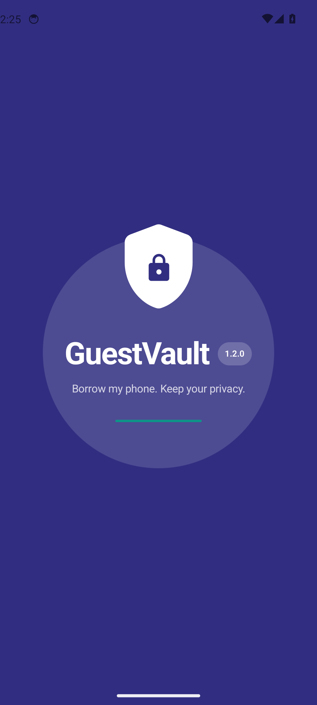 | 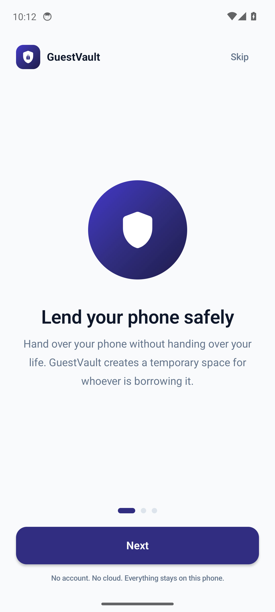 | 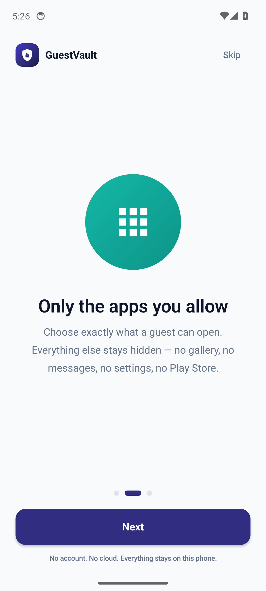 | 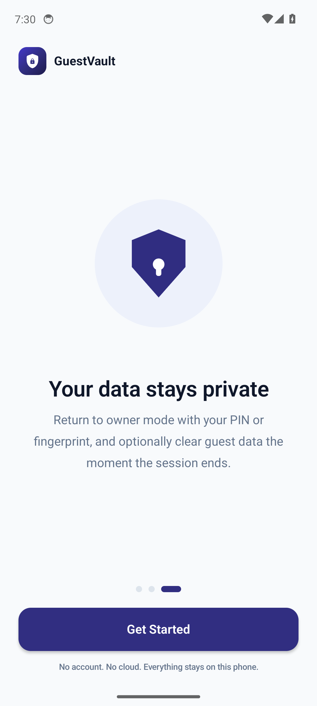 |

| Create the owner PIN | Confirm the PIN | | |
|:--:|:--:|:--:|:--:|
| 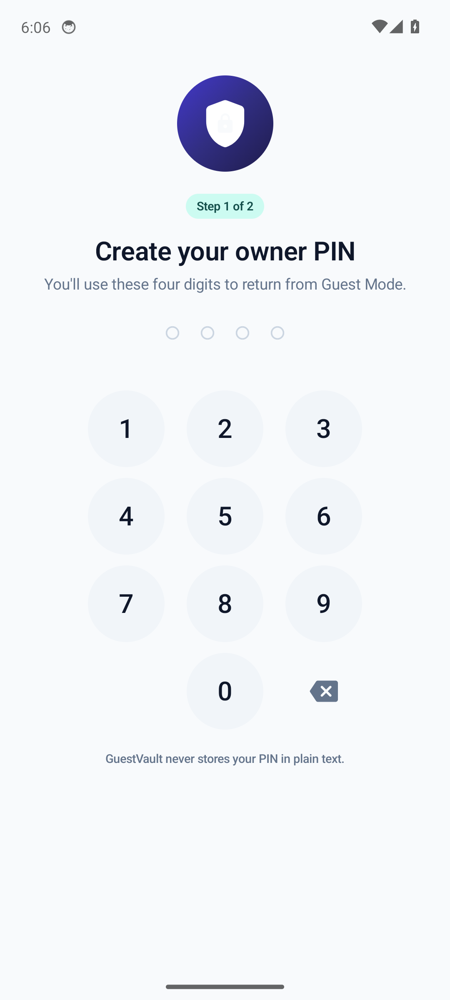 | 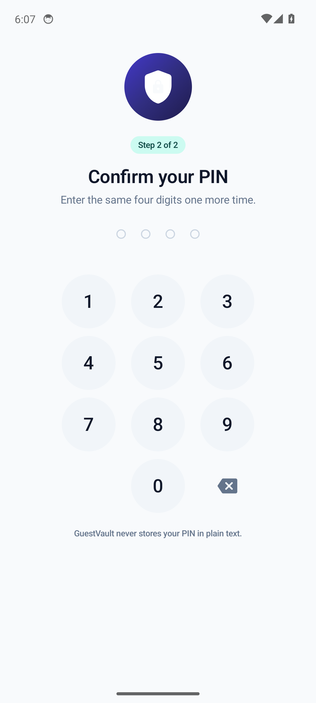 | | |

**Owner mode**

| Dashboard | Choose allowed apps | Confirm & start | Settings |
|:--:|:--:|:--:|:--:|
| 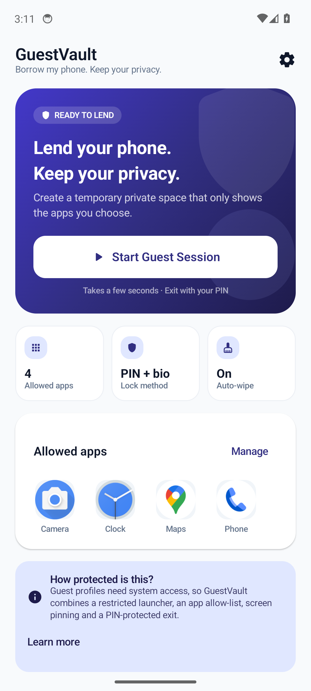 | 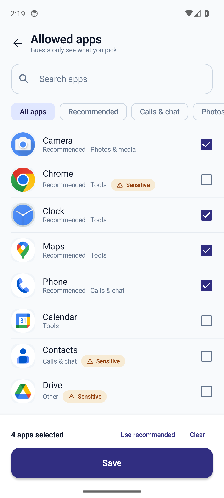 | 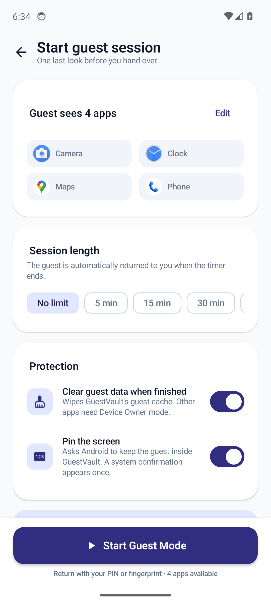 | 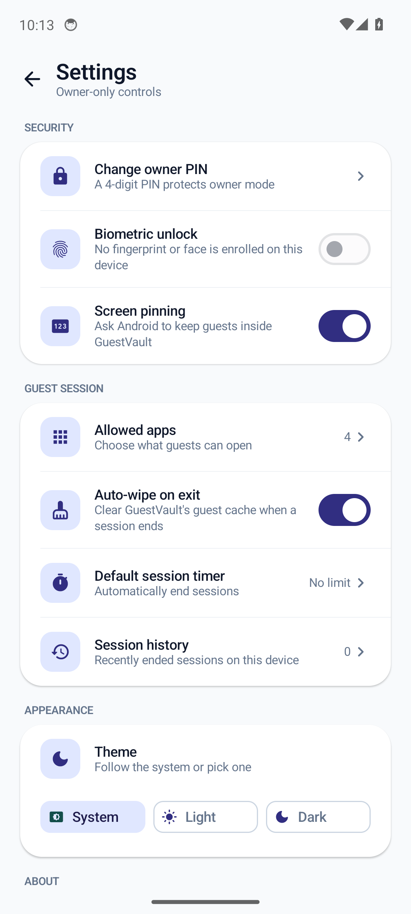 |

**Guest mode**

| Restricted guest home | Session options | PIN-protected exit | Wrong PIN → cool-down |
|:--:|:--:|:--:|:--:|
| 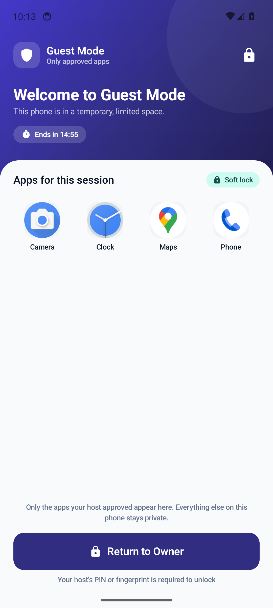 | 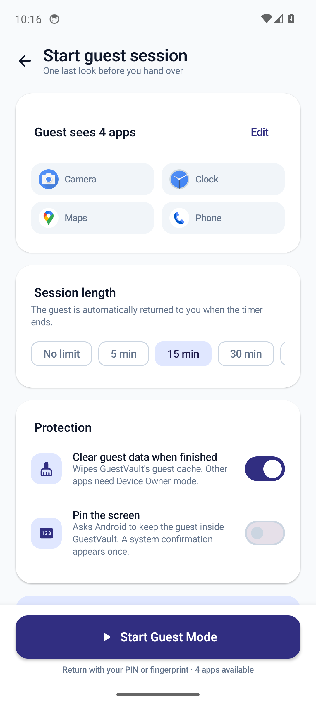 | 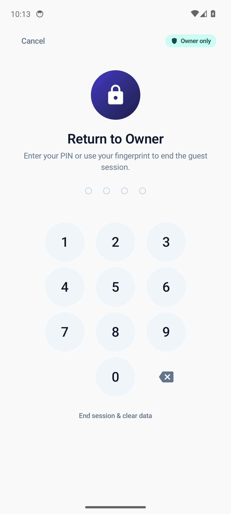 | 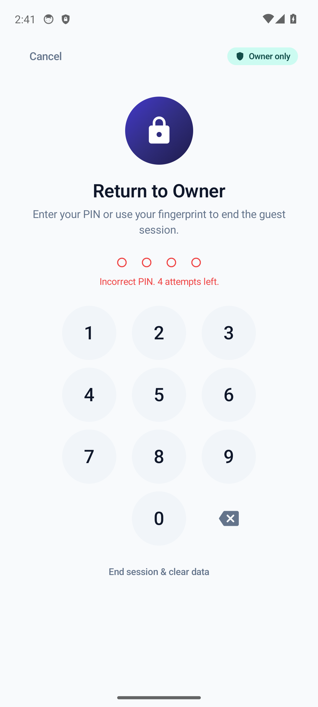 |

**After the session**

| Dashboard + history | Dark theme | About & limitations | Permissions & privacy |
|:--:|:--:|:--:|:--:|
| 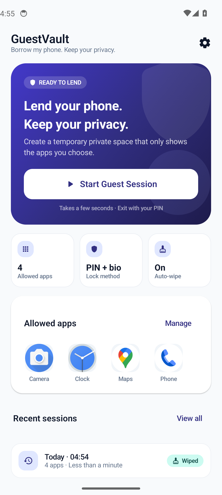 | 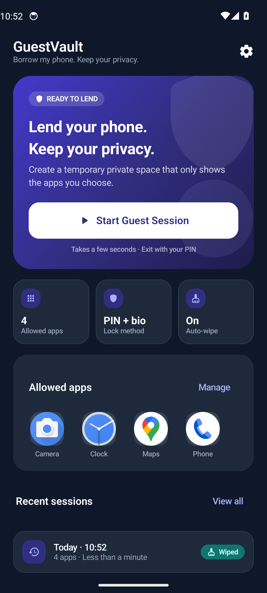 | 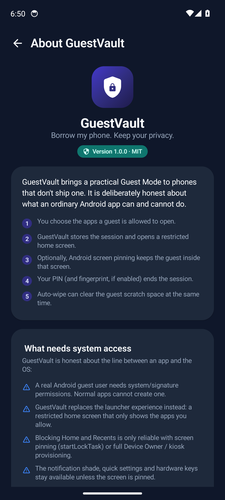 | 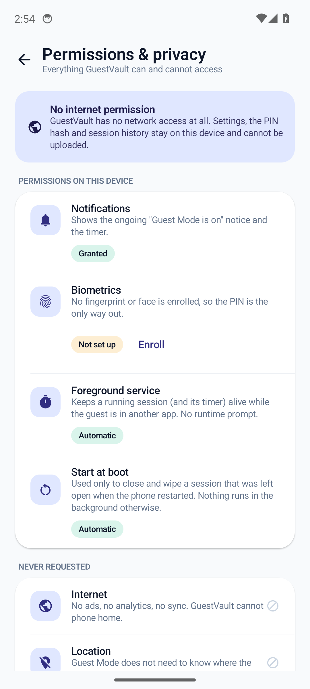 |

## ✨ Features

**Owner**
- 3-page onboarding, then a 4-digit owner PIN
- Material 3 dashboard (light + dark, following the system by default)
- Allow-list with search, categories, "recommended" and "sensitive" markers
- Session setup: allowed-app summary, optional timer, auto-wipe, screen pinning
- Settings: change PIN, biometrics, screen pinning, default timer, theme, history
- **Permissions & privacy** screen: every permission it holds, and the eight it deliberately
  never asks for
- **Quick Settings tile**: start a session (or jump back into a running one) without opening
  the app

**Guest**
- A clean, launcher-style home that only shows the apps you approved
- Live countdown when a session timer is set
- "Return to Owner" always one tap away — but it needs your PIN or fingerprint

**Protection**
- PIN is stored only as a salted **PBKDF2-SHA256** hash inside `EncryptedSharedPreferences`
- 5 wrong attempts start a cool-down that **doubles** (30 s → 60 s → … capped at 15 min) and is
  persisted, so rotating the device or killing the activity never resets it
- Optional Android **screen pinning** (`startLockTask`) so Home/Recents can't escape the guest UI,
  with an explicit warning banner when pinning was declined
- **Back is always consumed** inside the guest space — it can never finish the guest activity and
  drop the guest on the real launcher
- `FLAG_SECURE` on shipping builds: no screenshots, screen recordings or Recents thumbnails of
  the guest UI or the PIN pad
- Session is persisted to disk *before* the guest UI opens, so a crash can't "forget" a stranger is holding the phone
- Foreground service keeps timed sessions running even if the guest swipes the app away
- A reboot closes and (if auto-wipe is on) clears any session left open
- Auto-wipe of GuestVault's cache and guest scratch space when a session ends
- No internet permission, no analytics, no accounts, no backups, **no Device Administrator**

## 🖥️ Screens

| Screen | What it does |
|---|---|
| **Splash** | Brand mark and a fade into onboarding / dashboard. |
| **Onboarding** | Explains the three promises: lend safely, only approved apps, owner holds the keys. |
| **PIN setup** | Create and confirm the 4-digit owner PIN. Change-PIN verifies the current one first. |
| **Dashboard** | Hero CTA, allowed apps preview, lock method, auto-wipe state, recent sessions. |
| **Allowed apps** | Searchable list of every launchable app, with categories and sensitive-app warnings. |
| **Confirm session** | Summary, duration chips, auto-wipe and screen-pinning switches. |
| **Guest home** | Restricted grid, timer, "Return to Owner". No app drawer, no settings. |
| **Owner lock** | Full-screen PIN pad + biometric key, attempt counter, optional data wipe. |
| **Settings** | Security, session, appearance and privacy controls. |
| **History / About** | Privacy-safe session summaries and an honest limitations page. |

## 🔐 How the "guest mode" workaround works

Android only exposes real user profiles to privileged apps. GuestVault therefore layers five
ordinary-app techniques so the result behaves like a guest profile:

1. **Restricted launcher** — `GuestHomeActivity` runs in its own task and composes a home screen
   that only contains the allow-listed packages. There is no app drawer, no search, and no route
   back to the owner dashboard.
2. **Allow-list enforced at launch time** — the guest UI asks `SessionController` (the only writer
   of the session) whether a package belongs to the session before it calls `startActivity`.
   System launchers are never offered in the picker, because allowing one would let a guest escape.
3. **Screen pinning** — with the setting enabled, the guest activity calls `startLockTask()`.
   Android shows a one-time confirmation and then blocks Home/Recents. If the owner declines,
   GuestVault's soft lock remains in place.
4. **Secure exit** — returning to owner mode always goes through `GuestLockScreen`:
   PIN (PBKDF2 verified off the main thread) or `BiometricPrompt`, then the session is ended
   and the guest task is finished.
5. **Session integrity** — the session (allowed packages, start time, timer, wipe preference) is
   written to DataStore *before* the guest UI opens and only cleared after a successful unlock
   or timer expiry. A foreground service keeps the timer honest.

## ⚠️ What an ordinary app cannot do (and GuestVault doesn't pretend to)

| Capability | Normal app | GuestVault |
|---|---|---|
| Create a real Android guest user | ❌ system permission | Replaced by a restricted launcher |
| Fully block Home / Recents | ⚠️ only with screen pinning | Offered per session; needs the system confirmation |
| Read or wipe another app's private data | ❌ | **Not offered.** Device Owner needs provisioning a Play app cannot do, and Device Admin is a Play-policy minefield |
| Block the notification shade / quick settings | ❌ (needs kiosk/Device Owner) | Documented limitation; pinning reduces the risk |
| Watch what the guest types or opens | ❌ without an Accessibility Service | **Not implemented on purpose** |

If you need hardware-level isolation, use Android's built-in guest user or a fully managed
(kiosk) device — GuestVault is the best experience a Play-Store-style app can offer, and it says so
in the UI (Settings → About → *What needs system access*).

## 🏗️ Architecture

```
app/src/main/java/com/guestvault
├── MainActivity.kt                # owner entry point + theme
├── GuestVaultApp.kt               # @HiltAndroidApp, notification channel
├── core/                          # Formatters, AppLauncher, legal copy, notifications
│   └── security/PinHasher.kt      # PBKDF2-SHA256, constant-time compare
├── data/
│   ├── repository/                # DataStore settings, encrypted PIN, app catalog
│   └── session/                   # SessionController + GuestDataWiper
├── di/AppModule.kt                # Hilt bindings
├── domain/
│   ├── model/                     # GuestApp, GuestSession, OwnerSettings, SessionRecord…
│   ├── repository/                # interfaces
│   └── usecase/                   # ObserveSettings, StartGuestSession, VerifyPin…
├── guest/                         # restricted launcher + lock + session service
│   ├── GuestHomeActivity.kt
│   ├── GuestHomeScreen.kt
│   ├── GuestLockScreen.kt
│   ├── GuestSessionService.kt     # foreground service, timer enforcement
│   ├── GuestViewModel.kt / LockViewModel.kt
│   └── BiometricGate.kt
└── ui/
    ├── components/                # buttons, cards, PIN pad, app icons, dialogs
    ├── navigation/                # Navigation Compose graph
    ├── screens/                   # splash, onboarding, dashboard, selectapps, confirm,
    │                              # settings, history, pin, about
    └── theme/                     # Color, Type, Shape, Theme
```

**Patterns** — Clean Architecture (data → domain → presentation), MVVM with unidirectional state,
use cases for every owner action, Hilt for DI, DataStore for preferences, `StateFlow` +
`collectAsStateWithLifecycle` in the UI.

**Stack** — 100% Kotlin · Jetpack Compose · Material 3 · Hilt · Navigation Compose · DataStore ·
androidx.security (encrypted prefs) · BiometricPrompt · coroutines/Flow · minSdk 29 · targetSdk 35.

## 🧪 Testing & CI

| Workflow | What it runs |
|---|---|
| [**Android CI**](.github/workflows/android.yml) | Assembles the debug APK, runs JVM unit tests and Android Lint, uploads the APK and reports. |
| [**Screenshots & Demo Video**](.github/workflows/media.yml) | Boots a Pixel 6 emulator, records the walkthrough with `screenrecord`, runs the UiAutomator end-to-end test and commits fresh screenshots + video to `docs/media`. |
| [**Play Readiness**](.github/workflows/play.yml) | Builds the **release App Bundle**, runs release lint, asserts the manifest is Play-safe (no Device Admin, no internet, no storage/contacts/location), validates the store graphics, and runs the guest-mode walkthrough on **API 29, 34, 35 and 36**. |
| [**Release APK**](.github/workflows/release.yml) | Builds the release + debug APKs **and the Play bundle**, and publishes them (with the demo media and store graphics) on a [GitHub Release](https://github.com/Jacinth-19/GuestVault/releases). |

- **Unit tests** (`app/src/test`): PIN hashing (round-trip, salt uniqueness, tamper rejection),
  session timer math, history model, formatters, and the lockout escalation policy
  (5 attempts → 30 s, doubling to a 15-minute cap, counter surviving a cool-down).
- **Instrumented E2E** (`GuestVaultFlowTest`): onboarding → PIN creation → dashboard → settings →
  allow-list → session setup → guest home → wrong PIN → correct PIN → dashboard history → dark mode.
  The same test captures every screenshot in this README, and the flow is recorded to
  `docs/media/walkthrough.mp4`. It runs against a real emulator on every push.

Run them yourself:

```bash
./gradlew :app:testDebugUnitTest           # JVM tests
./gradlew :app:connectedDebugAndroidTest   # needs an emulator/device
```

> The E2E test uses the owner PIN `4726`. It is idempotent: it detects a previous onboarding and
> reuses the same PIN, so you can run it repeatedly on a warm emulator.

## 🚀 Build & run

### Install the APK from GitHub (no SDK needed)

Grab the latest **[release](https://github.com/Jacinth-19/GuestVault/releases/latest)**, download
`GuestVault-<version>.apk`, and open it on the phone (allow "install unknown apps" when asked).

Every push also builds a debug APK: open the green **Android CI** run → *Artifacts* →
**guestvault-debug-apk**.

```bash
adb install -r GuestVault-1.0.1.apk
```

The **Screenshots & Demo Video** workflow can be started from the *Actions* tab (or runs on `main`);
it commits refreshed images and the MP4 to `docs/media`.

### Locally

```bash
git clone https://github.com/Jacinth-19/GuestVault.git
cd GuestVault
./gradlew :app:assembleDebug
```

> The Gradle wrapper jar is binary, so CI bootstraps it on the first run with
> `gradle wrapper --gradle-version 8.11.1` and commits it back to the branch automatically.
> If it is missing in your checkout, run that same command once (or download the
> `gradle-wrapper` artifact from the latest Android CI run). Everything else — AGP 8.9,
> Kotlin 2.0, Compose BOM, Hilt — is pinned in `gradle/libs.versions.toml`.

Building the Play bundle:

```bash
./gradlew :app:bundleRelease     # app/build/outputs/bundle/release/app-release.aab
```

**Requirements:** JDK 17, Android SDK 36, a device or emulator on Android 10+ (API 29).

## 🔒 Privacy

- **No internet permission.** GuestVault cannot upload anything, by construction.
- Settings and the PIN hash stay in app-private storage; `android:allowBackup="false"`.
- Session history stores *when* a session ran, how many apps were allowed and *how it ended* —
  never what the guest opened or typed.
- Auto-wipe clears GuestVault's own cache and scratch directory. Other apps' data cannot be
  cleared by a normal app, and GuestVault does not request the Device Administrator role that
  would be needed on managed devices.
- Full text: [docs/privacy.html](docs/privacy.html) (published via GitHub Pages) and
  Settings → Privacy policy.
- Permission-by-permission disclosure: Settings → **Permissions & privacy**, or the same table
  in the privacy policy.

## 🗺️ Roadmap

- [x] Quick Settings tile to start a session
- [ ] Website allow-list / built-in safe browser
- [ ] Per-app and daily time budgets, plus schedules
- [ ] Multiple named guest profiles ("Mum", "the kids")
- [ ] Intruder photo after repeated failed unlocks
- [ ] Optional 6-digit PIN
- [ ] Emergency unlock code

Ranked against the competition in [`docs/COMPETITORS.md`](docs/COMPETITORS.md).

## 🏪 Google Play readiness

> **Status: code is ready; two human steps remain.**
>
> 1. **Play developer account** — not created yet. Start at
>    <https://play.google.com/console/signup> ($25 one-time, identity verification takes 1–3 days).
>    A new personal account then needs **12 testers for 14 continuous days** of closed
>    testing before Production is unlocked — start that clock as soon as the account verifies.
> 2. **Upload key** — not created yet, so releases publish sideloadable APKs but
>    **withhold the `.aab`** (Play rejects debug-signed bundles). One command, no laptop
>    needed — in a Codespace:
>
>    ```bash
>    bash scripts/play/create-upload-key.sh
>    ```
>
>    It generates the keystore, stores the four `UPLOAD_*` secrets, and verifies them.
>    You only press Enter for a generated password and approve one device-code sign-in
>    (`github.com/login/device`) — a Codespace token can read secrets but not write them.
>    Back up `~/upload-keystore.jks` **and** its `.credentials.txt`; neither file can
>    be committed.
>
> Everything else — listing copy, graphics, privacy policy, data-safety answers,
> foreground-service declaration and the review checklist — is written out in
> **[docs/PLAY_CONSOLE.md](docs/PLAY_CONSOLE.md)**, in the order that minimises waiting.

The app is prepared for a Play submission, and every claim here is checked in CI:

| | |
|---|---|
| Target | `compileSdk`/`targetSdk` **36** (Play's floor since 31 Aug 2026) |
| Artifact | **AAB** from `:app:bundleRelease`, published only when release-signed |
| Permissions | `POST_NOTIFICATIONS`, `FOREGROUND_SERVICE(_SPECIAL_USE)`, `USE_BIOMETRIC`, `RECEIVE_BOOT_COMPLETED` — **no** internet, storage, location, contacts, SMS, device-admin or accessibility |
| Store graphics | 512² icon, 1024×500 feature graphic, 8 screenshots at 1080×2160 (exactly 2:1) — validated on every push |
| Policy | Device Administration removed, FGS declared as `specialUse`, privacy policy published |
| Signing | upload-key signing wired in; the bundle is withheld unless it is release-signed |
| Privacy policy | <https://jacinth-19.github.io/GuestVault/privacy.html> |

- 📱 [**Play Console walkthrough**](docs/PLAY_CONSOLE.md) — account → listing → closed testing → production
- 🔍 [**Play review**](docs/PLAY_REVIEW.md) — what a reviewer would reject, and what changed
- 🔐 [**Security audit**](docs/SECURITY_AUDIT.md) — guest-escape analysis and residual risk
- 🥇 [**Competitors**](docs/COMPETITORS.md) — feature matrix and ranked roadmap
- 🏪 [**Store listing**](docs/STORE_LISTING.md) — copy-paste listing text and console answers
- 🎨 [**Listing assets**](docs/play/) — icon, feature graphic and screenshots

## 📄 License

MIT — see [LICENSE](LICENSE).

<div align="center"><sub>Built with Kotlin, Jetpack Compose, Material 3, Hilt and DataStore.</sub></div>
